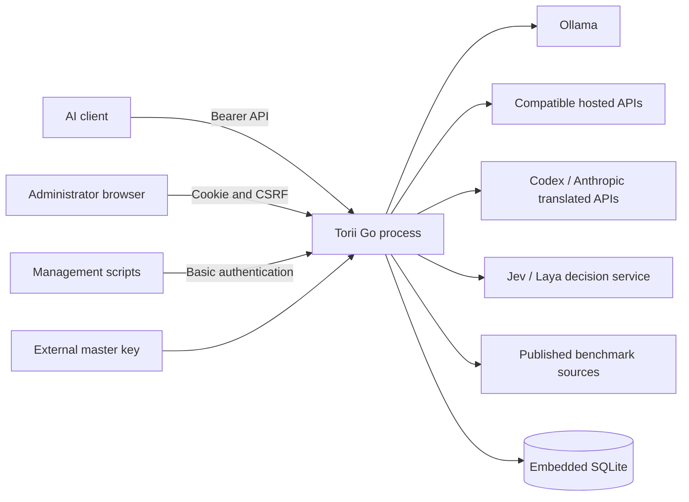

# Architecture

## Goals and constraints

Provide an OpenAI-compatible model gateway with low proxy overhead, bounded
routing work, isolated upstream credentials, and simple operation. One Go binary
embeds the console and SQLite; no database service, queue, Redis, or worker sidecar
is required. Durable state requires local storage and a separate master key.

## Context and deployment

Native deployments bind loopback by default in documented examples. Containers
bind all container interfaces and run as UID/GID 65532 with a persistent `/data`
volume and an external master key. A `/config` mount is needed only for an explicit
legacy import or referenced external files. HTTPS termination belongs to a trusted reverse proxy. One process owns
one local database volume; benchmark writer coordination is process-local.

## Building blocks

| Package | Responsibility |
| --- | --- |
| `cmd/gateway` | CLI, lifecycle, admin setup, config persistence/reload, OAuth orchestration |
| `cmd/torii-auth` | Optional legacy browser-host loopback login and single-use remote pairing |
| `internal/api` | Authentication, public endpoints, streaming, smart dispatch/evidence, errors |
| `internal/config` | Strict settings/import schema, references, defaults/validation |
| `internal/provider` | Discovery, profile-specific credentials/protocols/quota |
| `internal/transport` | Transparent JSON model rewrite and canonical translation contract |
| `internal/catalog` | Immutable model snapshots and tri-state metadata merge |
| `internal/classifier` | Connected/embedding/typed decision contracts and bounded execution |
| `internal/router` | Objective requirements, pure eligibility/ranking, intelligence utility |
| `internal/session` | Bounded in-memory identities, context signatures, affinity |
| `internal/quota` / `internal/usage` | Quota snapshots, aggregate accounting and background flush |
| `internal/intelligence` | Source adapters, identities, aggregation, refresh/store manager |
| `internal/accounting` | Durable per-key budgets, conservative reservations and JSON/SSE usage |
| `internal/activity` | Bounded request history, optional debug bodies, live events and redacted structured logs |
| `internal/state` | Encrypted records, admin/client keys, schemas, durable runtime/benchmark data |
| `internal/web` / `assets` | Embedded console/generated JS and project images |
| `internal/fault`, `requestid`, `buildinfo` | Shared error taxonomy, correlation, version metadata |

## Startup and shutdown

`serve` selects the database via CLI/environment, opens SQLite with the external
key, verifies encrypted records before applying migrations, then loads stored
settings (or fresh empty-provider defaults). It performs administrator setup and
constructs providers/catalog/routers. Persisted inline/env/file secrets are
rejected. YAML is read only by explicit `config validate` or `config import`;
normal startup never imports legacy state. Empty-provider setup is supported. Configured
provider discovery failures may use last-known-good/bundled fallback; an entirely
unusable configured inference catalog fails startup.

SIGINT/SIGTERM drains HTTP for up to ten seconds, cancels background workers,
then attempts final usage persistence with a separate ten-second deadline.
HTTP header reads have a ten-second timeout; idle connections close after 60 seconds.

## Request flow

1. Allocate/preserve a safe request ID and start structured completion logging.
2. Authenticate inference with a database-backed bearer key.
3. Validate bounded JSON and determine endpoint/objective requirements.
4. Resolve an explicit public ID directly, or run smart session/classification,
   eligibility, quota/cost/intelligence ranking, and pre-stream failure policy.
5. Dispatch via the provider-owned transport and relay JSON or stream.
6. Record safe routing evidence/latency and JSON/SSE operator usage.

Explicit requests cannot be substituted. Smart pins are revalidated against
current constraints; tool continuation requires its originating eligible pin.
Generic classification describes requirements. Jev chooses the physical model
from dynamic criteria for up to 250 configured candidates, using price, verified
capabilities and relevant benchmark scores. The gateway validates that choice;
other classifiers and failure fallback retain deterministic selection.
Benchmark fetching and aggregation run outside inference selection. Budgeted
requests reserve accounting capacity in SQLite before dispatch and settle usage
afterward; limited requests fail closed if that storage is unavailable.

## Transport and catalog

Transparent transport changes only the top-level model value and preserves
unknown fields and other JSON bytes. SSE bytes pass through and flush promptly.
Translated providers use canonical contracts or adapter-specific translation:
Codex adapts Responses and Anthropic adapts Messages. Not all native features
are exposed; unsupported behavior must be explicit. No reroute is possible after
downstream bytes commit. Client disconnect cancels upstream work.

Public IDs split at the first slash. Catalog metadata merges bundled records,
live authoritative values, then operator overrides. Tri-state endpoint/feature
support stays unknown until verified. Catalog snapshots are sorted/immutable;
failed providers retain stale previous entries independently. Decision-only
models expose System One passthrough and judge selection but are excluded from
chat inference candidates, including on mixed providers. Refreshes run at startup,
after login, and lazily on requests after one minute.

## Cross-cutting security and state

Management uses administrator Basic authentication and same-origin checks.
Public static/health/setup-status routes are distinct from protected management.
Pairing and callback routes validate pending token/state. API keys are encrypted
and checked using indexed digests plus encrypted-record verification. Provider
clients isolate credentials/TLS/timeouts; redirects cannot leak secrets.

SQLite stores validated settings and revisions; YAML is accepted for explicit import and validation. SQLite contains encrypted credential
payloads and readable benchmark/usage/host-identity data. Separate pools for
benchmark and usage writes prevent those writes queuing credential reads, though
SQLite still serializes competing writes. Usage is buffered/flushed every second.
Administrator sessions, budgets, reservations and activity history (including explicitly enabled debug bodies) are durable. Routing affinity, upstream live quota caches and pending OAuth flows remain memory-only.

## Decisions and risks

See [Design](design.md), [Decisions](decisions.md), [State and security](state-and-security.md),
[Routing](routing.md), and [Intelligence](intelligence.md). External schema changes,
unknown capabilities/quality, lost keys, and stale benchmark evidence are material
limits. Dated test evidence is in [Evaluations](evaluations/smart-routing/README.md);
work state and deferred capabilities live only in [Status](status.md).
